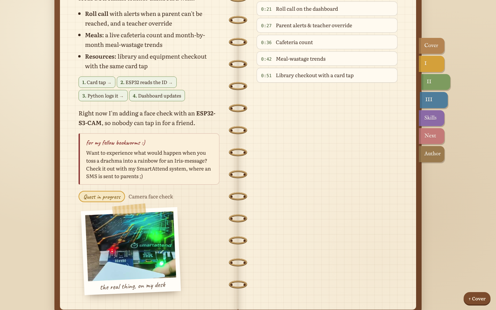

# 📖 The Making of an Engineer

**My portfolio website, designed as a vintage ring-bound field journal.** Each project I've built is a chapter of the book, and each chapter has something you can try.

Built by **Joanne** with plain HTML, CSS and JavaScript.

🔗 **Live site:** https://joannebjomy.github.io/  <!-- ✏️ EDIT if your repo name is different -->



---

## 📌 Project Overview

**Idea:** A personal portfolio that tells my story as a *builder's journey*. Rather than a list of projects, it reads like a journal: a title page, a table of contents, three chapters (one per project), an inventory of skills, my next chapter, and an "About the Author" page.

**Purpose:** To show who I am through the things I've built. Visitors can actually *use* my projects in the browser, not just read about them.

**Target audience:** Club recruiters (IEEE WIE), classmates and anyone curious about my projects.

## ✨ Features

| Chapter | What you can do |
|---|---|
| **Cover** | Title page with a clickable table of contents |
| **I: Strings into Art** | Grow an L-system fractal live (fern, bush, dragon curve, snowflake) |
| **II: The Card That Remembers** | Watch real footage of my SmartAttend RFID system, with clickable scene markers that jump the video to each feature (card tap, roll call, parent alerts, cafeteria count, meal-wastage trends, library checkout) |
| **III: Reading the Early Signs** | "Am I at risk?" checker that runs my real KNN model (k = 11, trained on the same 316 students as my ML notebook), with a Decision Tree second opinion |
| **Skills** | An RPG-style inventory showing where I picked up each skill |
| **Next Chapter** | A quest log of my goals that you can tick off |

**Other features**
- 🗂️ **Coloured chapter tabs** as the navigation menu. They highlight the chapter you're reading, and on mobile they become a scrollable strip along the top.
- 📱 **Responsive:** two-page spreads on desktop, single pages on phones.
- ♿ Keyboard friendly, visible focus outlines, and animations turn off for people who prefer reduced motion.

## 🛠️ Technology Stack

- **HTML5:** page structure, one `<section>` per chapter
- **CSS3:** grid and flexbox layout, custom properties for the chapter colours, media queries for responsiveness, CSS-only paper, rings, tape and stamps
- **JavaScript (no libraries):**
  - `IntersectionObserver` for the active tab and the fractal growing on first view
  - Canvas API for drawing the L-system
  - HTML5 `<video>` with scene buttons that jump to timestamps
  - A K-Nearest Neighbors classifier written from scratch
- **Google Fonts:** IM Fell English, Literata, Caveat
- **Hosting:** GitHub Pages

## 🗂️ Files

```
index.html       the journal: every chapter and page
style.css        all the styling and the responsive layout
script.js        tabs, fractal generator, video scenes, risk checker
model-data.js    training data for the KNN model (from my ML project)
smartattend.mp4  real footage of SmartAttend running
smartattend-poster.jpg / smartattend-still.jpg   stills from the video
preview.png      screenshot used in this README
```

## ⚙️ Setup Instructions

No installation or build step is needed.

**Run it locally**
1. Download or clone this repository:
   ```bash
   git clone https://github.com/Joannebjomy/joannebjomy.github.io.git
   ```
2. Open `index.html` in any modern browser (Chrome, Edge, Firefox or Safari).

**Deploy it with GitHub Pages**
1. Push the files to a GitHub repository.
2. Go to **Settings → Pages**.
3. Under **Source**, choose **Deploy from a branch**, pick `main` and `/ (root)`, then click **Save**.
4. After a minute the site is live at `https://<username>.github.io/<repo-name>/`, or at `https://<username>.github.io/` if the repo is named `<username>.github.io`.

## 🔗 Related projects

- [L-System Fractal Generator (Python)](https://github.com/Joannebjomy/L-FRACTAL-SYSTEM-PYTHON)
- [Early Warning: Student Performance Prediction (ML)](https://github.com/Joannebjomy/student-performance)
